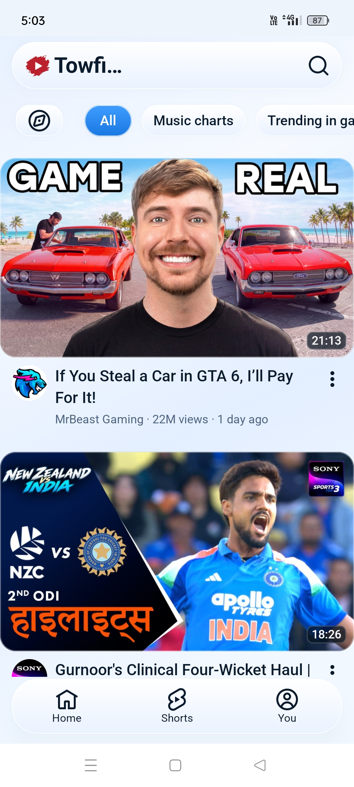
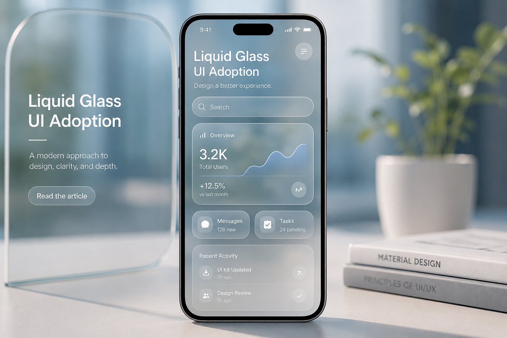
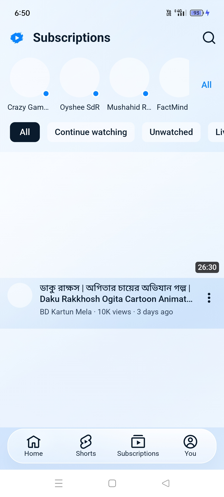
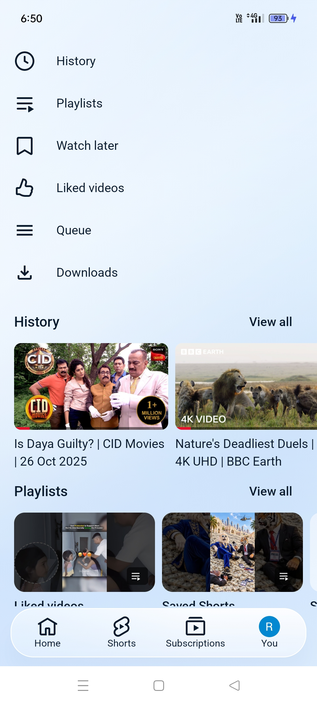

<div align="center">


# Towfik Youtube

**A liquid-glass blue build of [Litube 4.0.0](https://github.com/HydeYYHH/litube)** — an unofficial,
open-source YouTube client for Android.

Rebranded, restyled, and rebuilt from the upstream Gradle project
(`com.hhst.litube`, versionCode 400, minSdk 24, targetSdk 36).

<p>
  
  
  
  
</p>

</div>

---

## What this repository is

This is the **complete, buildable source** of the liquid-glass rebuild of Litube 4.0.0 that was made for
`Towfik Youtube`, plus the design documentation, the signed APK, and the app icon set.

Everything here is derived from the upstream Litube project. The upstream code, license and attribution are
preserved — see [docs/UPSTREAM_README.md](docs/UPSTREAM_README.md), [LICENSE](LICENSE) and
[NOTICE.md](NOTICE.md) for exactly what was changed.

## Screenshots

| Home (light) | Style reference used |
|---|---|
|  |  |

### More app screens

| Subscriptions | You: history and playlists |
|---|---|
|  |  |

Two device screenshots are kept as evidence of bugs that were found and fixed in later revisions — they are
history, not the current look:

- `docs/screenshots/02-bug-blank-home-behind-mini-player.jpg` — revision 3: the mini-player overlay painted a
  full-screen backdrop over the home feed. Fixed in revision 4.
- `docs/screenshots/03-bug-watch-page-black-in-light-mode.jpg` — revision 3: the watch page used a transparent
  window backing, which renders black in light mode. Fixed in revision 5.

The animated design preview (light + dark, no device needed) is
[docs/design-preview.html](docs/design-preview.html).

## What was changed from upstream Litube 4.0.0

| Area | Change |
|---|---|
| Branding | App name `Litube` → **Towfik Youtube** in 92 `strings.xml` files (460 strings); launcher icon recoloured to blue `#0A84FF` at all 5 densities; in-app corner mark `#BB202D` → `#0A84FF` |
| Design system | New `ui/design/LiquidGlass.kt` (glass fills, hairlines, highlights, shadows, `Modifier.liquidGlass`, `Modifier.glassMediaFrame`, `Modifier.liquidSheen`, `Modifier.glassWallpaper`); `ui/design/GlassWallpaper.kt` (frosted backdrop drawable) |
| Theme | Full blue palette, transparent screen backgrounds, translucent Material3 surface roles, larger radius scale |
| Chrome | Floating glass top bar, chip row, and nav docks on every browse screen; frosted app bars, sheets and dialogs |
| Motion | Slow water-like sheen (7.2 s / 9.6 s / 5.2 s) on the floating chrome, **disabled** when the system animator scale is 0 |
| Layout | Search moved to a glass pill in the **right corner** of the home top bar |
| Update check | The GitHub release lookup in `AboutActivity` was removed — the app no longer phones home for updates |
| Not touched | No permission changes, no endpoint changes, no new libraries (no blur dependency), no database/schema changes, no backend or data edits |

The full, honest engineering log — including the two bugs this work introduced and how they were fixed — is in
[docs/CHANGE_REPORT.md](docs/CHANGE_REPORT.md).

## Install

1. Download `dist/Towfik-Youtube-4.0.0-LiquidGlass-Everywhere-v5.apk`
   (8,693,827 bytes · SHA-256 `bdc6fbe46d8bd9954864c99760cebab7f3a82541f270e8a31eb691e963058d32`).
2. Open it on the phone and allow *Install unknown apps* if prompted.
3. Play Protect may warn — normal for any self-signed APK.

**Signature:** signed with a local self-signed key (cert SHA-256 `07:34:A1:93:…:CD:3F`), v2 + v3 schemes.
Because the signature differs from the upstream/modder builds, installing over an app signed with a different
key requires uninstalling it first, **which erases its data**. Updating over a previous build from this repo
works in place.

## Build it yourself

Requirements: JDK 21, Android SDK with **platform 36** and **build-tools 36.0.0**.

```bash
# point Gradle at your SDK
echo "sdk.dir=/path/to/Android/Sdk" > local.properties

export JAVA_HOME=/path/to/jdk-21
export ANDROID_HOME=/path/to/Android/Sdk
./gradlew :app:assembleRelease
```

The unsigned APK lands in `app/build/outputs/apk/release/app-release-unsigned.apk`.

Sign it with your own key (never commit a keystore or its passwords):

```bash
BT=$ANDROID_HOME/build-tools/36.0.0
$BT/zipalign -p -f 4 app-release-unsigned.apk aligned.apk
$BT/apksigner sign --ks my-release.keystore --ks-key-alias mykey \
  --v1-signing-enabled true --v2-signing-enabled true --v3-signing-enabled true \
  --out Towfik-Youtube.apk aligned.apk
```

On a low-RAM machine the R8 step can be OOM-killed; this build was produced with
`-Dorg.gradle.jvmargs="-Xmx1400m -XX:MaxMetaspaceSize=400m" -Dorg.kotlin.compiler.execution.strategy=in-process -Dorg.gradle.workers.max=2 --no-daemon --no-parallel`
plus a 4 GB swapfile.

## Repository layout

```
app/                     the Android application (Kotlin, Jetpack Compose)
  src/main/java/com/hhst/youtubelite/ui/design/    glass design system
  src/main/res/                                    icons, strings, themes
assets/icon/             app icon: 512 px, light/dark previews, adaptive XML, all densities
dist/                    the signed release APK
docs/                    change report, design preview, screenshots, upstream README
fastlane/                upstream store metadata
```

## Credits

- **[Litube](https://github.com/HydeYYHH/litube)** by HydeYYHH — the app this is built from (GPL-3.0).
- Built on a fork of [MediaServiceCore](https://github.com/HydeYYHH/MediaServiceCore), the YouTube engine used by
  [SmartTube](https://github.com/yuliskov/SmartTube), and inspired by
  [NewTube](https://github.com/aleixrodriala/newtube).

## Disclaimer

Unofficial client. Not affiliated with, endorsed by, or connected to YouTube or Google. You are responsible for
how you use it and for complying with the terms of any service it accesses. The software is provided as-is, with
no warranty, under the GNU General Public License v3.

**One honest limitation of this design:** the frosted look is produced by translucent panels over a designed
backdrop. There is **no live backdrop blur** of scrolling content, because Jetpack Compose cannot sample what is
drawn behind a node. Adding that would require a third-party library and is not part of this build.
